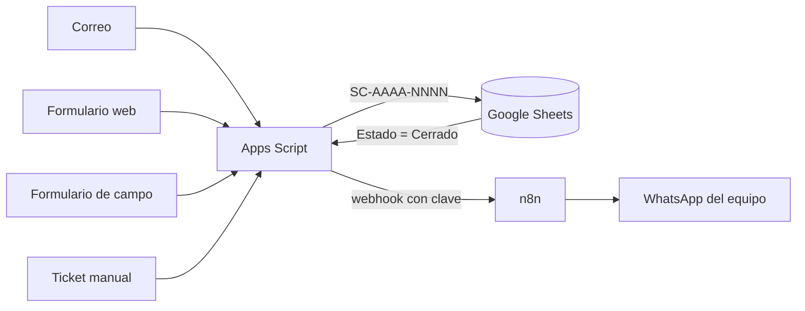

# Mesa de ayuda con tickets (Google Apps Script)

Convierte las solicitudes de soporte de un área de sistemas en **tickets numerados** (`SC-AAAA-NNNN`), los registra en Google Sheets y avisa al equipo por **WhatsApp**. Hecho para una oficina pública de atención al ciudadano con varios puntos de atención; aquí está en versión genérica, sin datos ni configuración real.

## Qué hace

- **Cuatro entradas, un solo contador:** correo de soporte (revisado cada 5 minutos), formulario web público, formulario de campo de los supervisores y tickets manuales desde un menú de la hoja.
- **Lee correos sin plantilla:** si falta información, responde pidiendo nombre, correo, punto y detalle; cuando la persona contesta completo, crea el ticket. Reconoce el punto de atención por palabras clave.
- **Aviso a WhatsApp** del grupo de soporte a través de un webhook (n8n + WAHA en mi caso). El mensaje lleva número, punto y detalle, nunca nombres ni correos.
- **Cierre automático:** al marcar *Cerrado* en la hoja, avisa el cierre por WhatsApp y le envía un correo a quien pidió el soporte.
- **Formulario web** que devuelve el número de ticket al instante, con campo trampa contra robots, sin duplicados por doble clic (misma persona y detalle en 15 min = mismo ticket) y trazabilidad por correo.

## Hecho para no fallar

- Contador con `LockService` para que dos procesos nunca tomen el mismo número.
- Reintentos ante errores pasajeros de Google y aviso solo si fallan 6 vueltas seguidas.
- Detección de tickets parecidos y resincronización.
- Ignora remitentes y asuntos propios (confirmaciones, rebotes) para no crear tickets en bucle.

## Instalación

1. Crea una hoja de cálculo y abre **Extensiones → Apps Script**. Pega `Codigo.gs`.
2. En **Configuración del proyecto → Propiedades del script** agrega:

   | Propiedad | Para qué |
   |---|---|
   | `SHEET_ID` | ID de la hoja de tickets |
   | `CORREO_SOPORTE` | correo de la cuenta que atiende |
   | `WHATSAPP_URL` / `WHATSAPP_TOKEN` | (opcional) webhook y clave del aviso |
   | `FORM_SHEET_ID` | (opcional) hoja del formulario de campo |
   | `FORM_WEB_URL` | (opcional) URL de la app web publicada |

3. Ajusta `PUNTOS` y `NOMBRE_EQUIPO` al inicio del archivo.
4. Crea un disparador por tiempo cada 5 minutos para `procesarCorreos`, ejecuta una vez `instalarMenuTickets` y, si usas el formulario de campo, `instalarDisparadorFormulario`.
5. Para el formulario web: **Implementar → Aplicación web**, ejecutar como *Yo*, acceso *Cualquier persona*.

Las claves y los ID nunca van en el código: viven en las propiedades del script.

---
Autor: [Albert Bermúdez](https://albert-3105.github.io)
